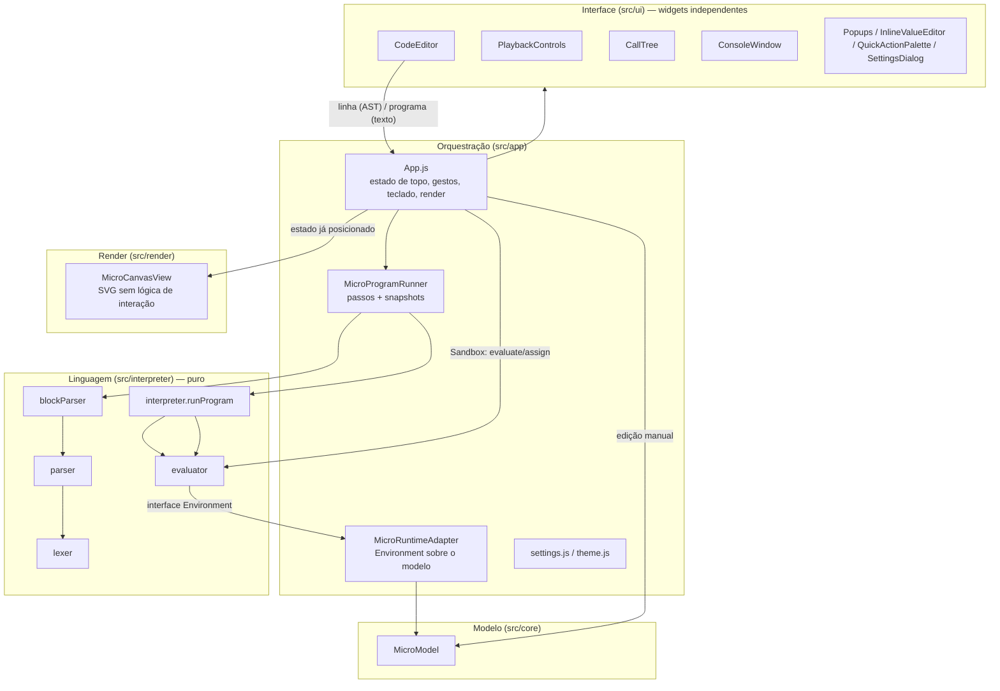

# Arquitetura e referência de código

Guia de onboarding pra quem vai contribuir com o **Algo-Lab** (antes "Visualizador de Estruturas de Dados & Algoritmos"). Ele explica como o sistema é organizado, o que cada módulo e cada arquivo faz, como os dados circulam entre eles e **onde mexer** pra fazer as tarefas mais comuns (novo built-in da linguagem, novo elemento visual, nova ferramenta da barra, nova configuração etc.).

> O documento descreve o código como está hoje. Se você mudar algo estrutural (um fluxo, uma interface entre módulos, uma convenção), atualize também este arquivo e o `CLAUDE.md`.

---

## Sumário

1. [Visão geral](#1-visão-geral)
2. [Como rodar](#2-como-rodar)
3. [Mapa do repositório](#3-mapa-do-repositório)
4. [Arquitetura em camadas](#4-arquitetura-em-camadas)
5. [Conceitos centrais](#5-conceitos-centrais)
6. [Fluxos de ponta a ponta](#6-fluxos-de-ponta-a-ponta)
7. [Referência por arquivo](#7-referência-por-arquivo)
8. [Receitas: onde mexer pra tarefas comuns](#8-receitas-onde-mexer-pra-tarefas-comuns)
9. [Convenções e armadilhas](#9-convenções-e-armadilhas)
10. [Como verificar uma mudança](#10-como-verificar-uma-mudança)

---

## 1. Visão geral

A ferramenta roda inteira no navegador (não tem backend) e serve pra **visualizar o modelo de memória** de programas que manipulam ponteiros e coleções: nós de lista, árvore e grafo, ponteiros, listas, sets, deques, dicionários, matrizes e variáveis escalares, desenhados num canvas SVG com pan e zoom.

Há duas formas de povoar o canvas, e elas convivem:

- **À mão**, no canvas: criar elementos (Ctrl+Espaço → `new pointer`, `new node`…), arrastar pra ligar ponteiros, editar valores com duplo clique.
- **Por código**, numa linguagem pequena com cara de Python (a "DSL") escrita no painel à direita. São dois modos:
  - **Sandbox** (interno: `'manual'`): Ctrl+Enter executa só a linha do cursor contra o modelo atual.
  - **Simulação** (interno: `'run'`): o programa inteiro (com `if`/`while`/`for`/`def`/recursão) é executado de uma vez, e o resultado vira uma reprodução passo a passo (play, pause, voltar e avançar), com árvore de chamadas e console de `print`. Clicar em "Simulação" põe o foco no editor; **Ctrl+Shift+Enter**, com o foco em qualquer lugar (canvas, editor no Sandbox ou na Simulação), passa pra Simulação e já roda o programa inteiro (`CodeEditor#runAll`).

Além dos elementos do modelo, o canvas tem **elementos de anotação**, que só existem no canvas e não fazem parte da execução: labels de texto, áreas hachuradas e gráficos de complexidade Big-O.

**Stack:** JavaScript puro com ES modules, sem framework. O DOM é montado à mão (`document.createElement`) e o SVG com um helper (`svgEl`). O Vite é a única dependência de desenvolvimento; as de runtime são só duas fontes (`@fontsource/*`). Comentários e textos da interface ficam em **português (pt-BR)**, e isso vale também pra código novo.

---

## 2. Como rodar

```bash
npm install
npm run dev       # servidor Vite em http://localhost:5173
npm run build     # build de produção em dist/
npm run preview   # serve o build de produção localmente
npm test          # testes automatizados (Vitest, pasta tests/)
npm run test:watch  # testes em modo observação
```

- **Testes:** `tests/` tem a suíte automatizada (Vitest) — linguagem comparada ao Python real, interpretador, modelo, reprodução e um teste de integração que monta o app inteiro no jsdom. Organização e onde pôr um teste novo: [tests/README.md](../tests/README.md). O CI (`.github/workflows/testes.yml`) roda `npm test` e `npm run build` em push na `main` e em pull request. Não há linter nem checagem de tipos, e os testes não enxergam o desenho (o jsdom não faz layout) — ver [seção 10](#10-como-verificar-uma-mudança).
- `.claude/launch.json` tem configurações prontas de dev server (`algo-visualizer`, porta 5173, e `algo-visualizer-5174`).
- **Deploy:** Cloudflare Pages via integração Git (não há workflow de deploy no repositório; o de `.github/workflows/` só roda os testes e o build). O build é `npm run build`, a saída fica em `dist/` e a versão do Node está fixada em `.node-version`. `public/_headers` vai pra `dist/` e define cache longo pros arquivos com hash em `/assets/*`. O app é servido na raiz do domínio, então `vite.config.js` não define `base`; se um dia for pra um subcaminho (ex.: GitHub Pages), é preciso definir.

---

## 3. Mapa do repositório

```
index.html                  página única; aplica o tema salvo antes do 1º paint e carrega os CSS
vite.config.js              config mínima do Vite (porta 5173, saída em dist/)
public/_headers             cabeçalhos de cache do Cloudflare Pages
vitest.config.js            config dos testes (pasta tests/, ambiente Node por padrão)
scripts/run-dsl.mjs         roda um programa da DSL em Node, sem navegador (verificação rápida do interpretador)
tests/                      testes automatizados (Vitest) — ver tests/README.md
  dsl/                      programas da DSL x saída do Python real, execução, bugs conhecidos
  interpreter/  core/  app/  ui/   testes por camada (ui/App.test.js monta o app inteiro no jsdom)
  helpers/                  runDsl (roda um programa sem DOM) e montarApp/tecla (DOM)
.github/workflows/testes.yml  CI: npm test + npm run build em push/PR
.github/pull_request_template.md  modelo de descrição de PR (em pt-BR)
.claude/skills/              skills do Claude Code pras tarefas comuns (receitas da seção 8 + verificação)
src/
  main.js                   ponto de entrada: importa as fontes, aplica o tema, faz `new App(root)`
  app/                      orquestração (estado de topo e "cola" entre as camadas)
    App.js                  a classe App: monta a UI, guarda todo o estado de topo, trata gestos e teclado, renderiza
    MicroRuntimeAdapter.js  implementa a interface Environment do interpretador em cima do MicroModel
    MicroProgramRunner.js   motor da Simulação: roda o programa, tira snapshots, controla a reprodução
    microLayoutKey.js       chave estável (por nome) pra lembrar a posição dos elementos entre execuções
    microAlign.js           alinhar/distribuir retângulos (funções puras, usadas pela AlignToolbar)
    microTreeLayout.js      organizar uma árvore binária por níveis (função pura, usada pela TreeLayoutToolbar)
    settings.js             preferências do usuário (localStorage, um objeto só)
    theme.js                tema escuro/claro (data-theme no <html>)
  core/
    id.js                   nextId(prefix): gerador único de ids
    micro/MicroModel.js     o modelo de dados (structs, ponteiros, arrays, dicts, matrizes, variáveis)
  interpreter/              a linguagem: puro, não conhece o MicroModel nem o DOM
    lexer.js                tokeniza UMA linha
    parser.js               recursive descent: uma linha vira um nó de AST
    blockParser.js          programa inteiro: blocos por indentação, if/while/for/def
    ast.js                  construtores dos nós de AST (objetos planos)
    interpreter.js          runProgram: generator que executa e faz `yield` de um passo por ação
    evaluator.js            evaluate/assign: semântica das expressões e atribuições, valores tipados, built-ins
    format.js               mini-linguagem de formatação de f-string ({x:>8.2f})
    pyset.js                tabela hash de set idêntica ao CPython 3.11 (ordem dos elementos)
    pytuple.js              tupla imutável e "internada" (guardável no modelo, usável como chave)
  render/
    MicroCanvasView.js      renderizador SVG + constantes de geometria + funções de layout e de "portas"
    labelMarkdown.js        markdown básico das labels de texto: parser por linha/trecho + geometria (labelLayout)
    textMeasure.js          largura de texto nas fontes do app (OffscreenCanvas, com estimativa sem canvas)
    svgUtils.js             svgEl(tag, attrs)
  ui/                       widgets de interface independentes, instanciados e ligados pelo App
    CodeEditor.js  CallTree.js  PlaybackControls.js  ConsoleWindow.js  ModeToolbar.js  AlignToolbar.js
    TreeLayoutToolbar.js
    QuickActionPalette.js  AppMenu.js  Tutorial.js  tutorials.js  SettingsDialog.js  ShortcutsDialog.js  Dialog.js  CanvasTitle.js
    NodePopup.js  ArraySettingsPopup.js  LabelSettingsPopup.js  ChartSettingsPopup.js
    InlineValueEditor.js  fitPopup.js
  styles/
    variables.css           tokens de cor e tipografia (tema escuro + override do claro)
    main.css                layout base da página
    canvas.css              tudo que é desenhado no SVG (nós, setas, destaques, cores manuais)
    controls.css            botões, popups, menu, diálogos, barra de modos, quick actions
    codeEditor.css          painel de código, divisórias, barra de reprodução, árvore de chamadas, console
```

Tamanho aproximado (linhas): `App.js` ~4500, `MicroCanvasView.js` ~2300, `evaluator.js` ~2050, `MicroRuntimeAdapter.js` ~1200, `CodeEditor.js` ~900, `MicroModel.js` ~740. Os demais têm poucas centenas de linhas ou menos.

---

## 4. Arquitetura em camadas



As regras de dependência que mantêm isso de pé:

| Camada | Pode importar | Não pode conhecer |
|---|---|---|
| `interpreter/` | só arquivos de `interpreter/` | `MicroModel`, DOM, SVG, `App` |
| `core/` | `core/id.js` e `interpreter/pytuple.js` (pra reviver tuplas no `loadFrom`) | renderização, interpretador, DOM |
| `render/` | `svgUtils.js` | o modelo como classe, o `App`, eventos. Recebe objetos simples já posicionados |
| `ui/` | `fitPopup.js`, `settings.js`, constantes de `render/`, parser (no `CodeEditor`) | o `MicroModel` (comunica por callbacks) |
| `app/` | tudo | — |

A peça que desacopla a linguagem do modelo é a **interface `Environment`** (duck typing, documentada no topo de `evaluator.js`). O avaliador só chama métodos como `resolveName`, `assignName`, `getAttr`, `getIndex`, `arrayAppend`… e quem os implementa sobre o `MicroModel` é o `MicroRuntimeAdapter`.

---

## 5. Conceitos centrais

### 5.1 O modelo (`MicroModel`)

São seis `Map`s indexados por id. Nenhum elemento sabe se desenhar.

| Map | Forma (campos principais) | Observações |
|---|---|---|
| `structs` | `{id, x, y, data, type:'list'\|'tree'\|'graph', next, prev, neighborsArrayId}` | `type` só muda os **nomes** dos campos expostos (`next/prev` ↔ `left/right`). Fisicamente sempre são `next`/`prev`. Um nó `graph` guarda os vizinhos num array `kind:'ref'` à parte (`neighborsArrayId`); `toggleStructNeighbor` liga/desliga uma aresta direcionada (ferramenta "Ligar nós"). |
| `pointers` | `{id, x, y, label, target, frameId}` | `target`: `null` ou `{kind:'struct', id}` \| `{kind:'arrayCell', arrayId, index}` \| `{kind:'array', id}` \| `{kind:'dictCell', dictId, key}` \| `{kind:'dict', id}` \| `{kind:'matrixCell', matrixId, row, col}` \| `{kind:'matrix', id}`. |
| `arrays` | `{id, x, y, kind:'value'\|'ref'\|'arrayref', orientation, cells, name, frameId, labelPointerId?, isSet?, hashTable?, isDeque?, maxlen?}` | Listas, sets e deques são arrays (sets e deques são marcados com uma flag). Até `MAX_ARRAY_SIZE` (32) células. `kind`: valores crus, ids de struct (`'ref'`) ou ids de **outros arrays** (`'arrayref'` — lista de listas, `[[1], [2, 3]]`; as listas de dentro são arrays sem nome, chamados `res[0]`…, só alcançáveis pela célula, e a seta de cada célula vai pra lista inteira). Numa lista de listas, `orientation: 'grid'` desenha as listas de dentro como **linhas de uma tabela** ("matriz"), irregulares se tiverem tamanhos diferentes — é com ela que nasce uma lista de listas novas de valores do mesmo tamanho (`[[0] * c for _ in range(l)]`), e o popup troca (ver `layoutGrids` em 7.5). `orientation`: `'horizontal'`, `'vertical'` ou `'stack'` (pilha — vertical com o índice 0 embaixo e o último elemento no topo; não vale pra set). Quem só precisa saber se é vertical usa `isVerticalOrientation` (`MicroCanvasView.js`); só `arrayLayout` inverte a ordem das células. A pilha cresce pra cima com a base parada: `y` continua sendo o topo da caixa, então `_keepStackBase` o desloca a cada mudança de tamanho (levando junto o rótulo com o nome, se está acima — `ridesStackTop`), e o `MicroProgramRunner` guarda a posição da pilha (e desse rótulo) relativa à base (`{x, y, bottom: true}`). Rótulos discretos de ponta, fora do layout (`arrayEndCaptions`): "topo" no último elemento de uma lista em pilha; num deque, "início" na posição 0 e "fim" na última (um acima do outro quando é o mesmo elemento) e `maxlen=n` à parte — acima das células na horizontal, acima do puxador / abaixo da caixa na vertical; linha de grade (`gridRow`) não tem. `arrayOuterBox` (no App, `_microArrayOuterRect`/`_microOccupiedRect`) é a caixa + puxador + esses rótulos, usada pra achar espaço livre e enquadrar a vista. |
| `dicts` | `{id, x, y, orientation, cells: {key, kind:'value'\|'ref'\|'arrayref', value}[], name, frameId, labelPointerId?}` | O `kind` é **por célula** (um dict pode misturar valores e nós). |
| `matrices` | `{id, x, y, name, cells: valor[][], frameId, labelPointerId?}` | Grade retangular só de valores. **Em desuso:** o código e o `new matrix` criam uma lista de listas em grade (`arrays`, `orientation: 'grid'`); o tipo só continua no modelo até ser removido. |
| `variables` | `{id, x, y, name, value, frameId}` | `value`: `number`, `string`, `boolean` ou `PyTuple`. |

Pontos importantes:

- **Heap × frames.** Structs, arrays, dicts e matrizes são o "heap" compartilhado e aparecem em qualquer aba. Ponteiros e variáveis têm `frameId` (`'global'` ou o id de uma chamada), e só os do frame em exibição (mais os globais) são desenhados. O `frameId` de um array, dict ou matriz diz só a qual frame pertence o **nome** dele (uma coleção criada numa chamada some no fim dela, a menos que continue alcançável — ver `releaseDeadArrays`).
- **Ponteiro-rótulo.** Arrays, dicts e matrizes não têm barra de título. O nome aparece num ponteiro dedicado (`isArrayLabel`/`isDictLabel`/`isMatrixLabel`) que aponta pra coleção inteira. Ele nasce à esquerda da coleção, longe o bastante pra seta aparecer (ver "Ponteiro de um elemento novo", na seção do `App`). O popup de configurações da coleção abre pelo botão direito no **puxador** dela (a aba à esquerda ou acima da caixa), não nesse ponteiro — o botão direito no ponteiro-rótulo só bloqueia o menu nativo.
- **Cursor de leitura.** Ler `nums[i]` no código cria (ou move) um ponteiro especial com `readCursorKey = "nums[i]"`, que aponta pra célula lida e é recalculado quando `i` muda (`MicroRuntimeAdapter#_showReadCursor` e `_refreshDependentCursors`). Cursores são excluídos do `toJSON` e reaparecem quando o código roda de novo.
- **Integridade referencial.** Os métodos `remove*` anulam referências pendentes (ponteiros e células que apontavam pro elemento removido). Sempre use a API do `MicroModel` em vez de mexer nos `Map`s direto.
- **Serialização.** `toJSON()`/`loadFrom()` preservam os ids, já que as referências são por id, e toleram arquivos malformados ou de outras versões.

### 5.2 Valores tipados (avaliador)

Dentro do interpretador, todo valor é `{kind, ...}`: `scalar`, `string`, `bool`, `none`, `struct` (referência por id), `tuple`, `dict` (um `Map` vivo), `array`/`nodelist`/`nestedlist`/`set`/`deque`/`matrix` (literais de vida curta que viram elementos do modelo ao serem atribuídos; `nestedlist` é a lista de listas — itens `arrayref`, listas novas ou None —, e listas novas do mesmo tamanho continuam virando `matrix`), `arrayref`/`matrixref`/`matrixrow` (referências a coleções vivas no modelo), `range`, `iter`, `pairs`. A lista completa e comentada fica no topo de `evaluator.js`.

`evaluate` devolve **`undefined`** quando algo não resolve (nome desconhecido, índice inválido, chamada não suportada). É o mecanismo de "ignora a linha": no Sandbox, a linha pisca vermelha; na Simulação, o passo é contado e nada muda. Avisos legíveis vão pro console via `env.warn(...)`.

### 5.3 A interface `Environment`

É o contrato entre `evaluator.js`/`interpreter.js` e o mundo. Os métodos essenciais são `resolveName`, `assignName`, `getAttr`, `assignAttr`, `getIndex`, `assignIndex`, `getLength`, `createStruct`, `arrayAppend`, `arrayPop`, mais opcionais pra cada recurso (`iterateArray`, `print`, `matrixInfo`, `getMatrixCell`, `isSet`, `setAdd`, `isDeque`, `dequeSetItems`, `assignDictKey`, `warn`, `hashSeed`…) e os de recursão (`pushFrame`, `popFrame`, `currentFrameId`, `stableRef`, `releaseDeadArrays`). O avaliador testa a presença dos opcionais (`env.warn?.(...)`).

**Regra prática:** se você adicionar um recurso à linguagem que precise ler ou escrever o modelo, ele entra como um método novo na interface, implementado em `MicroRuntimeAdapter`.

### 5.4 Passos, snapshots e reprodução

`runProgram` é um **generator**. Cada `yield` é um passo `{line, kind, activeFrameId, callTree}`, com `kind` sendo `'assign'`, `'expr'`, `'test-true'`/`'test-false'`, `'for-bind'`, `'return'`, `'break'`, `'continue-stmt'` ou `'limit'`. O `MicroProgramRunner` consome o generator **inteiro** no "Rodar" e, depois de cada passo, guarda:

- `touched`: os elementos lidos ou escritos naquele passo (pro destaque);
- `snapshot`: cópia dos dados **lógicos** do modelo, sem `x`/`y` e sem orientação;
- `output`: as linhas de `print` até ali.

Navegar entre passos **restaura um snapshot**, ou seja, troca os `Map`s do `MicroModel`. As posições ficam fora dos snapshots (`positions`, e `stepLayout` com quadros-chave por passo), assim o usuário pode arrastar elementos durante a reprodução sem que voltar um passo "puxe" tudo de volta.

Há duas guardas: `MAX_STEPS = 2000` (loop infinito) e `MAX_CALL_DEPTH = 200` (recursão sem caso base).

### 5.5 Identidade estável × id

Ids (`nextId`) nunca se repetem: cada "Rodar" recria os elementos com ids novos. Tudo que precisa sobreviver entre execuções usa uma **chave estável**:

- `App#microLayout`: posição escolhida pelo usuário, por chave de `microLayoutKey.js` (`pointer:global:head`, `array:nums`, `cursor:nums[i]`…). Nunca é limpo entre execuções, só ao criar ou carregar um projeto.
- `MicroProgramRunner#stepLayout`: quadros-chave de posição por passo, com chave do tipo `array:call:leftHalf#2`.
- `App#microWindows`: janelas deslizantes, por chave de cursor (`nums[l]`). A cor da janela (`color`) também mora aqui: é a cor única dos dois cursores e do colchete, e por isso sobrevive a novas execuções e ao save/load.

Já `App#microColors` (cor manual) é por **id**, e funciona porque os snapshots preservam os ids dentro de uma execução. O canvas recebe `App#_microEffectiveColors()`, que é `microColors` com a cor de cada janela aplicada aos seus cursores; Alt+1…Alt+0 num cursor de janela muda a cor da janela, não a do id.

**Arestas/setas** (next/prev/left/right, vizinhos de grafo, setas de ponteiro e de célula) também são selecionáveis e pintáveis: `MicroCanvasView#_renderEdges` desenha, por aresta, um alvo de clique invisível (`.micro-edge-hit`, `data-edge-id`), e `App#_onMicroPointerDown` o trata como `hit: 'edge'` — acima de áreas/gráficos, abaixo de qualquer elemento. O id da aresta (`<id do dono>-next`, `-cell3`…) entra em `microSelectedId(s)`, mas só serve pra pintar (Alt+1…Alt+0 / roda de cores → `App#microEdgeColors`, salvo no projeto como `edgeColors`): arrastar não move nada e Delete as ignora (`_isMicroEdgeId`). A cor vira `stroke` inline na linha e um `<marker>` por cor (`_edgeMarkerFor`).

### 5.6 Elementos do modelo × elementos de anotação

| | Elementos do modelo | Elementos de anotação |
|---|---|---|
| Onde ficam | `MicroModel` | `App#microLabels`, `App#microAreas`, `App#microLines` (setas e réguas), `App#microCharts` |
| Afetados pela reprodução | sim (snapshots) | não |
| Acessíveis pelo código | sim | não |
| Criáveis durante a Simulação | não (sumiriam no próximo passo) | sim |
| Salvos no projeto | `project.micro` | `project.labels/areas/charts` |

---

## 6. Fluxos de ponta a ponta

### 6.1 Sandbox: Ctrl+Enter numa linha

```
CodeEditor#_handleGenerateFromLine
  ├─ blockParser.js#logicalLineAt → statement inteiro da linha ativa (pode ocupar várias linhas)
  ├─ "if/elif/while cond:" → parseExpression → App#_evaluateCondition (escreve "> True"/"> False" no console)
  └─ demais → parseStatement(linha) → App#_executeStatement(ast)
        evaluate(ast.value, microRuntime) + assign(ast.target, valor, microRuntime)
          └─ MicroRuntimeAdapter muta o MicroModel e registra `touched`; cada toque chama onChange → render
        App#_applyMicroTouchHighlight(touched) → App#_renderMicroOnly()
  └─ flashLine verde (ok) / vermelho (erro de sintaxe ou exceção)
```

No Sandbox não há `def`, `if` com bloco nem loops: é um statement por vez — que pode ocupar várias linhas físicas com colchete aberto ou `\` no fim (ex. um dict com um par por linha); com o cursor em qualquer uma delas, Ctrl+Enter roda o statement inteiro e pisca todas.

### 6.2 Simulação: "▶ Rodar"

```
CodeEditor (modo 'run': ▶, Ctrl+Enter; ou Ctrl+Shift+Enter de qualquer modo → runAll) → onRun(código) → App#_runMicroProgram
  → MicroProgramRunner#run(source, microRuntime)
       parseProgram(source)               (erro → runner.error → barra mostra "Erro de sintaxe (linha N)")
       for (step of runProgram(program, functions, env)):
           snapshot + touched + output    (um registro por passo)
       _restore(steps[0])
  → onChange → App#_renderMicroOnly → _renderMicroRunBar (PlaybackControls + linha em execução no editor)

PlaybackControls / Ctrl+, / Ctrl+.  → MicroProgramRunner#goToStep(i) → _restore(snapshot) → onSelect(touched) + onChange
```

Durante `runProgram`, uma chamada a uma função do usuário passa por `callFunction`: `env.pushFrame(label)`, bind dos parâmetros via `env.assignName`, `yield* execBlock(corpo)`, `env.popFrame()` e `env.releaseDeadArrays(...)`, que remove as listas locais que não foram devolvidas. A árvore de chamadas (`callTree`) só cresce e vai junto em cada passo; ao retornar, o nó é substituído por uma cópia com `returned`, `returnText` e `scope` (foto dos parâmetros/locais do frame, via `env.frameScope` → `frameScope.js`), que o `CallTree` mostra como `→ valor` e no pop-up do hover (chamadas ainda na pilha usam `frameScope` sobre o modelo do passo atual). A largura do painel é arrastável (`callTreeWidth`). O `App` usa `activeFrameId` pra decidir quais ponteiros e variáveis mostrar, e o `CallTree` permite trocar a aba manualmente (`App#manualFrameId`).

### 6.3 Interação no canvas (gestos)

Todo o tratamento de entrada fica no `App`. O hit testing é feito **contra o modelo**, não contra o DOM: as funções `_findMicro*At(worldPt)` usam as mesmas funções de geometria que o renderizador (`arrayLayout`, `pointerWidth`, `structNextPort`…).

```
pointerdown (App#_onMicroPointerDown)
   decide o tipo do gesto e grava this._microPointer = { hit: 'pan' | 'text-canvas' | 'area-create'
     | 'chart-create' | 'link-drag' | 'link-new-node' | 'area-resize' | 'port' | 'node' | 'areaselect' | ... , downScreen,
     worldPtDown, ... }
   e registra pointermove/pointerup na window
pointermove (App#_onMicroPointerMoveWindow) → atualiza rascunhos (_microDragPos, _microAreaDraft,
   _microChartDraft, _microPortDrag, _microLinkDraft, _microSelectionPreview) → render
pointerup (App#_onMicroPointerUpWindow) → confirma: move o elemento (e grava microLayout/stepLayout),
   liga o ponteiro (App#_resolveMicroDropTarget → MicroModel#setPointerTarget/setField), liga/desliga
   prev/next ou um vizinho de nó de grafo (App#_applyMicroLink → setField/toggleStructNeighbor), cria a
   área/gráfico/label, seleciona…
dblclick (App#_onMicroDblClick)        → edição in place (dado, célula, nome, texto, eixo);
                                         numa divisória entre células de array → _splitMicroArray
contextmenu (App#_onMicroContextMenu)  → popups de configurações (label, coleção pelo puxador — App#_findMicroHandleUnder,
                                         já selecionando a coleção —, gráfico); ponteiro, variável ou struct por cima bloqueiam
wheel (App#_onMicroWheel)              → zoom
pointermove no <svg>, sem arrasto      → App#_onMicroHoverMove: guarda a posição do mouse e, sem botão
   (App#_onMicroHoverMove)               pressionado, mostra a leitura do gráfico sob ele (sem tecla —
                                         App#_updateMicroChartReadout → chartReadout); o wheel relê no
                                         mesmo ponto depois do zoom; some em blur, pointerleave e no
                                         início de qualquer gesto (volta no próximo hover)
```

Pan: botão do meio, ou botão esquerdo com Espaço pressionado (o cursor vira a mão de pan enquanto o Espaço está pressionado — classes `space-pan`/`panning` no container, ver `App#_setSpaceDown`). Clique simples só seleciona; toda edição in place abre com duplo clique; Delete/Backspace remove.

Ligar nós (ferramenta 5/L): o gesto padrão é **clicar no nó de origem e depois no de destino**. Num Node/TreeNode, a metade do nó onde se clica escolhe o ponteiro — esquerda = `prev`/`left`, direita = `next`/`right` (`App#_microLinkFieldAt`; `left`/`right` são fisicamente `prev`/`next`) —, e o hover com a ferramenta destaca essa metade (`_microLinkHover`, via `_onMicroHoverMove` → `_updateMicroLinkHover`; desenhado por `MicroCanvasView#_renderLinkSource` com a geometria pura `structLinkFieldPath` — célula prev/next no modo detalhado, meio círculo no simplificado, célula "nbrs"/círculo todo num nó de grafo). O primeiro clique deixa a ligação **pendente** (`_microLinkDraft = {fromId, field, toPt, targetId, pending: true}`, sem gesto de ponteiro aberto): a seta de rascunho (`previewEdge`, saindo do pino do campo escolhido) segue o mouse, **Tab** troca prev↔next (`_toggleMicroLinkField`, tratado no topo de `_onKeyDown`, antes do Tab-pro-código) e Esc ou o **botão direito** (`_onMicroContextMenu`) cancelam mantendo a ferramenta (`_cancelMicroLink`). O segundo clique, num nó do **mesmo tipo** (`_findMicroLinkTarget` — Node com Node, TreeNode com TreeNode, grafo com grafo; nunca o próprio nó), conclui por `_applyMicroLink`: num Node/TreeNode, `MicroModel#setField` aponta o campo pro destino ou o anula se já apontava pra ele; num nó de grafo, `_toggleMicroGraphNeighbor` → `MicroModel#toggleStructNeighbor` põe o destino no fim de `neighbors` ou tira (todas as ocorrências) — só a aresta A→B muda, nunca B→A; cria a lista de vizinhos de um nó sem ela (projeto antigo) e respeita `MAX_ARRAY_SIZE` (avisa no console). Clicar de novo na origem recomeça pela metade clicada; clicar num elemento que não serve de destino não faz nada; com a ligação pendente, clicar em **espaço vazio** (nenhum elemento além de áreas — `_microLinkDropAt` devolve `newNodeAt`) cria ali um nó do mesmo tipo do de origem já ligado (`_createMicroLinkedNode`: centrado no ponto, dado 0, via `_microAddNode` — o de grafo com a lista de vizinhos, `movable: false` —, liga por `_applyMicroLink`, seleciona e abre a edição do dado; a criação fica pro pointerup, `hit: 'link-new-node'`, senão o foco do mousedown fecharia o editor). Antes do clique, um **círculo vazio tracejado** marca onde o nó vai nascer (`newNodeGhost` → `MicroCanvasView#_renderNewNodeGhost`, classe `.new-node-ghost`), e a seta de rascunho para na borda dele. Durante a ligação (pendente ou no Shift + arraste), um **rótulo junto do cursor** diz o que concluí-la ali faz: "criar e conectar" (espaço vazio), "conectar" ou "desconectar" (em vermelho — o destino já é o alvo daquele ponteiro, ou já está em `neighbors`, e `_applyMicroLink` desligaria); nenhum rótulo sem destino sob o cursor. A operação vem de `_microLinkAction`, e o desenho de `MicroCanvasView#_renderLinkHint` (`linkHint`, textos em `LINK_HINT_TEXT`, camada `link-hint-layer` por cima de tudo, abaixo e à direita da ponta do cursor e com o mesmo tamanho na tela em qualquer zoom — a escala do viewport é desfeita). Sem ligação pendente, clicar em espaço vazio (`_microElementAt` falso) volta pra ferramenta Selecionar. **Shift + arraste** a partir de um nó — ou do pino prev/next dele, que sem Shift é o arraste de pino — (na ferramenta ou no modo Selecionar) mantém o gesto antigo de arrastar e soltar: `_startMicroLinkDrag` abre `hit: 'link-drag'` com o campo da metade onde começou (ou do pino), e o pointerup liga ao soltar sobre um destino válido ou, em espaço vazio, cria o nó ligado do mesmo jeito (com o mesmo círculo tracejado durante o arraste). Antes de soltar, **Esc** ou o **botão direito** desistem (`_abortMicroLinkDrag`): o botão direito com o esquerdo pressionado chega como `pointermove` com `buttons & 2` e/ou como `contextmenu` — este capturado na `window` (fase de captura, `_onMicroLinkDragContextMenu`), que também engole o `contextmenu` atrasado (no Windows ele vem ao soltar o botão), pra não abrir menu nenhum. Shift + clique sem arraste deixa a ligação pendente na ferramenta, e só seleciona no modo Selecionar. É o gesto que faltava pra religar "neighbors" à mão: `_findMicroPortAt` continua pulando os nós `graph`. Como os arrastes de pino, vale também durante a reprodução da Simulação (a mudança fica no passo em exibição). O Shift + arraste só vira ligação quando começa num nó; em célula de lista/matriz continua criando cursor de leitura.

Alinhar e distribuir: com 2+ elementos selecionados aparece, logo acima da barra de modos, a `AlignToolbar` (alinhar à esquerda/centro/direita/topo/meio/fundo; com 3+, também distribuir na horizontal/vertical — os mesmos 8 comandos estão no Ctrl+Espaço como `align …`/`distribute …`). `App#_runMicroAlignAction` monta o retângulo desenhado de cada elemento (`_microElementRect`: coleções com a aba, nó simplificado só o círculo), calcula os deslocamentos com `microAlign.js` e aplica por `_microSetNodePos`, o mesmo caminho de soltar um arraste (na reprodução, vale só pro passo atual). A referência do alinhamento é o primeiro elemento selecionado — a ordem de inserção de `microSelectedIds` é a ordem de clique/Ctrl+clique —, que não se move; numa seleção que começou por retângulo (`_selectMicroRect` marca o Set em `_microAnchorlessSelection`, e `_toggleMicroSelection` repassa a marca), vale o extremo do grupo. Distribuir deixa o mesmo espaço livre entre vizinhos, com o primeiro e o último (pelo centro) parados.

Organizar como árvore: com exatamente um TreeNode (struct `type: 'tree'`) selecionado aparece, no mesmo lugar, a `TreeLayoutToolbar` com "Árvore ↕" (níveis um abaixo do outro) e "Árvore ↔" (níveis lado a lado, filho esquerdo acima do direito) — também no Ctrl+Espaço como `layout tree vertical`/`layout tree horizontal`. As duas barras dividem o mesmo host em linha (`.align-toolbar-host`, flex), então nunca se sobrepõem. `App#_runMicroTreeLayout` arranja a **subárvore** que começa no nó selecionado (structs não guardam o pai), com ele parado no lugar, seguindo só left/right (campos físicos `prev`/`next`) que apontam pra outro TreeNode; a matemática é `microTreeLayout.js#treeLayout` (compacta, por contornos de subárvore, estilo Reingold–Tilford; filho único vai pro seu lado; um nó já visitado — ciclo ou dois pais — entra uma vez só). O tamanho da caixa vem de `_microElementRect` (círculo no modo simplificado) e as folgas de `TREE_GAPS`, por orientação e modo. Aplica por `_microSetNodePos` (na reprodução, vale só pro passo atual). Ponteiros e variáveis não se movem, e structs não têm chave de layout por nome, então rodar o programa de novo volta às posições padrão.

Leitura de gráfico Big-O (mouse sobre o gráfico, sem tecla e sem botão pressionado): o x do mouse vira o inteiro n mais próximo em [0, floor(nMax)] — fora da área de plotagem ele é preso nos limites do eixo (à direita do fim do eixo n lê n máximo, à esquerda da origem lê 0, pra dar pra pegar o último ponto sem acertar o x exato) — e, entre as curvas marcadas que existem em n (`from`) e não saíram pelo topo (f(n) ≤ yMax), vale a de menor distância vertical até o cursor — ponto e guia na cor da curva, n acima do eixo n e f(n) ao lado do ponto, os dois textos na cor de texto do tema (`--text-0` em `canvas.css`: quase branco no escuro, escuro no claro — o render não põe `fill` neles). Com gráficos sobrepostos, lê o de cima. É estado transitório (`App#_microChartReadout`, passado ao render como `readout` do gráfico): fora do `MicroModel`, dos snapshots e do projeto; só re-renderiza quando muda gráfico, n ou curva.

### 6.4 Render

`App#_renderMicroOnly()` é **o** render. Ele é chamado depois de praticamente qualquer mudança e:

1. renderiza a `ModeToolbar`, a `AlignToolbar` (com o número de elementos selecionados que dá pra mover) e a `TreeLayoutToolbar` (se há um só TreeNode selecionado, `_microSelectedTreeRoot`);
2. calcula o frame ativo, os destaques (seleção, `touched` do passo, alvos "linkados" dos ponteiros destacados, janelas deslizantes) e o que está fora de escopo (fica esmaecido);
3. monta arrays de objetos simples de render, um por tipo de elemento, já com posição (incluindo arraste em andamento), flags (`selected`, `dragging`, `cursor`, `linked*`…) e âncoras de setas;
4. monta a lista de `edges` (setas) com origem e alvo;
5. chama `this.microView.render({...})`;
6. atualiza o `CodeEditor` (nomes conhecidos), o `CallTree`, a barra de reprodução (`_renderMicroRunBar`) e o console (`_renderMicroConsole`);
7. registra `_microInertIds` (o que não está desenhado ou está esmaecido não recebe clique, ver `_microPickable`).

Antes disso, o item 1 também liga/desliga a classe `dragging-elements` no `.micro-container` enquanto há um arraste de elemento ou de grupo (`_microDragId`/`_microGroupDragPositions`): o CSS tira dela a transição do traçado (`d`) das setas, que fica só para a reprodução passo a passo — com a transição durante o arraste, cada `pointermove` recomeçava a animação e a seta ficava atrás do elemento (o próprio elemento arrastado já não anima `transform`, por estar com `.dragging`).

`MicroCanvasView#render` faz um **diff por id**: cada `_render<Tipo>` mantém um `Map<id, <g>>`, remove os que sumiram, cria os novos e atualiza atributos e classes dos existentes. As camadas SVG, de trás pra frente, são: grid → áreas → gráficos → setas → arrays → cópias do halo das grades (`_syncGridHalos`) → dicts → matrizes → structs → ponteiros → variáveis → labels → alças de redimensionamento.

### 6.5 Salvar e carregar projeto

`App#_saveProject` baixa um `.json` `{format:'algo-visualizer-project', version:1, title, code, micro: MicroModel#toJSON(), labels, areas, charts, windows, colors, layout, stepLayout}`. `App#_loadProject` → `_readProjectFile` (valida) → `_applyLoadedProject` (pede confirmação se houver conteúdo, repõe tudo e reenquadra a vista).

### 6.6 Configurações

Preferências de tela (não do projeto) ficam num único objeto do localStorage (`algo-visualizer:settings`), gerenciado por `settings.js` (`getSetting`/`setSetting` com validação). **Toda** mudança passa por `App#_applySetting(key, value)`, seja vinda da janela `SettingsDialog`, seja de um atalho (G, N, C, Alt+C, Ctrl+A, Ctrl+H).

---

## 7. Referência por arquivo

### 7.1 Entrada e infraestrutura

| Arquivo | Responsabilidade |
|---|---|
| `index.html` | Página única. Um script inline aplica `data-theme="light"` antes do primeiro paint, pra evitar o flash do tema escuro. Carrega os 5 CSS e `src/main.js`. |
| `src/main.js` | Importa as fontes embarcadas (Atkinson Hyperlegible Next na interface, JetBrains Mono no código e no canvas), aplica o tema salvo e faz `new App(document.getElementById('app'))`. |
| `src/core/id.js` | `nextId(prefix)` → `"prefix-<contador>-<aleatório>"`. É o **único** gerador de ids. |
| `src/render/svgUtils.js` | `svgEl(tag, attrs)` cria um elemento SVG com namespace e ignora atributos `null`/`undefined`. |
| `src/render/labelMarkdown.js` | Markdown básico das labels de texto (o texto fica cru em `node.text`, formatado só no desenho). Cada linha é uma linha da label: `#`/`##`/`###` títulos, `-`/`*`/`+` e `1.`/`1)` listas (2 espaços de recuo = 1 nível; números alinhados à direita), blocos entre linhas ```` ``` ```` monoespaçados; na linha, `**negrito**`, `*itálico*`/`_itálico_`, `***os dois***`, `` `código` `` e escapes `\*`. `parseLabelMarkdown`/`parseInline` dão a estrutura; `labelLayout(text, fontSize, measure?)` a geometria (um trecho posicionado por `<tspan>`, marcadores, fundos de código), usada pelo render e — via `labelSize` — pelo hit-test; `labelSourceSize` mede o texto cru (caixa do editor in place, que mostra o markdown digitado, em mono). Também define `LABEL_PAD_X/Y` e `LABEL_LINE_HEIGHT`. |
| `src/render/textMeasure.js` | `measureText(text, {size, bold, italic, mono})`: largura de um trecho nas fontes do app, medida com `OffscreenCanvas` (cache por fonte+texto; fonte ainda não carregada pede o carregamento e não entra no cache). Sem canvas (jsdom/Node) estima por caractere. Quando as fontes terminam de carregar, zera o cache, sobe `textMeasureGeneration()` (entra na assinatura do render das labels) e avisa `onTextMeasureChange` (o `App` redesenha). |

### 7.2 `src/app/`

**`App.js`**: o orquestrador, monolítico de propósito. Lê-se por seção (procure os comentários `// ---- ... ----`), não de ponta a ponta.

| Seção / métodos | O que faz |
|---|---|
| Constantes de topo | `MICRO_MODES` (barra de ferramentas), paletas (`AREA_COLORS`, `TEXT_COLORS`, `ELEMENT_COLORS`), padrões de gráfico e label. |
| `constructor` | Todo o estado de topo: `micro`, viewport, modo, seleção (`microSelectedId` + `microSelectedIds`), anotações (`microLabels/Areas/Charts`), `microColors`, `microWindows`, `microLayout`, destaques de execução, `manualFrameId`, estado de gestos (`_microPointer`, `_microDrag*`…). |
| `_buildLayout` | Cria o DOM (canvas, painel de código, árvore de chamadas, divisórias) e instancia **todos** os widgets, ligando os callbacks. Também cria o `MicroRuntimeAdapter` e o `MicroProgramRunner`. |
| `_onKeyDown` / `_onKeyUp` | Todos os atalhos globais (Tab → código, Ctrl+,/. passos, Ctrl+H, Ctrl+Espaço, Ctrl+Shift+Enter → Simulação + rodar, Ctrl+A, Delete, Alt+dígito cor, Enter, Alt+C, 1-5/V/T/R/B/L modos, G, N, C). A ordem dos `if` importa: alguns valem mesmo digitando, outros não (`isTyping`). |
| Configurações | `_settingsValues`, `_applySetting`, `_resetSettings`. |
| Cores | `_paletteIndexFromKey`, `_applyMicroPaletteColor`. |
| Viewport | `_resetMicroViewport`, `_fitMicroViewport`, `_onMicroWheel`, `_microWorldToScreen`… |
| Projeto | `_newProject`, `_saveProject`, `_loadProject`, `_readProjectFile`, `_applyLoadedProject`. |
| Criação e posicionamento | `_microCreatePosition(kind, size, layoutKey, near)` (posição lembrada ou primeira posição livre perto do centro; com `near`, o ponteiro de um nó que acabou de nascer), `_microOccupiedRects`, `_findFreeMicroPosition` (com `side` — `left`/`right`/`above`/`below` —, só anda pra fora daquele lado), `_create{Array,Dict,Matrix}LabelPointer`, `_microPointerSpotNear`/`_microMoveWithPointer`/`_microPlaceUnderPointer` (ponteiro de um elemento novo, abaixo). |
| Execução | `_executeStatement`, `_evaluateCondition`, `_runMicroProgram`, `_onCodeEditorModeChange`, `_applyMicroTouchHighlight`, `_onSelectCallFrame`, `_microOutOfScopeIds`. |
| Popups de edição | `_openMicroDataPopup`, `_openMicroVariablePopup`, `_openMicro{Array,Dict,Matrix}CellPopup`, `_openMicro{Array,Dict,Matrix}SettingsPopup`, `_openMicroLabelSettingsPopup`, `_openMicroChartSettingsPopup`. |
| Elementos por id | `_microNodeMaps`, `_microFindById`, `_microRemoveById`, `_deleteMicroSelection`, `_microSetNodePos`, `_microNodePos`, `_microFindIdsInRect`, `_microLayoutKeyForLiveNode`. |
| Hit testing | `_microPickable`, `_findMicro{Struct,Pointer,Variable,Array,ArrayCell,Dict,DictCell,Matrix,MatrixCell,Label,Area,Chart}At`, `_findMicroPortAt`, `_resolveMicroDropTarget`. |
| Áreas e gráficos | `_snapMicroArea`, `_microAreaRectFromDrag`, `_microAreaResizedRect`, `_createMicroArea`, `_createMicroChart`. |
| Seleção múltipla e janelas | `_toggleMicroSelection`, `_selectMicroRect`, `_quickNewSlidingWindow`, `_microWindowPartner`, `_microWindowRange`. |
| Alinhar e distribuir | `_runMicroAlignAction`, `_microElementRect`, `_microAlignableIds`, `_microSelectionAnchor` (ver `microAlign.js`). |
| Organizar árvore | `_runMicroTreeLayout`, `_microSelectedTreeRoot` (ver `microTreeLayout.js`). |
| Quick actions | `_openQuickActions` (lista de comandos) e `_quickNew*` (um por comando), `_editMicroNameInPlace`, `_quickDiscard`. |
| Ligar nós | `_onMicroLinkPointerDown`, `_microLinkFieldAt`, `_findMicroLinkTarget`, `_microLinkDropAt`, `_microLinkAction`, `_createMicroLinkedNode`, `_updateMicroLinkHover`, `_toggleMicroLinkField`, `_cancelMicroLink`, `_startMicroLinkDrag`, `_abortMicroLinkDrag`, `_onMicroLinkDragContextMenu`, `_applyMicroLink`, `_toggleMicroGraphNeighbor` (ferramenta 5/L e Shift + arraste num nó, ver 6.3). |
| Cursores por gesto | `_findMicroCursorCellAt`, `_createMicroIndexCursor`, `_startMicroIndexCursorDrag`. |
| Setas | `_pointerAnchor`, `_structFieldAnchor`, `_computeStructPairOffsets` (de que lado da caixa sai o pino). |
| Gestos | `_onMicroPointerDown`, `_onMicroPointerMoveWindow`, `_onMicroPointerUpWindow`, `_onMicroContextMenu`, `_onMicroDblClick`, renomeações in place. |
| Render | `_renderMicroOnly`, `_renderMicroRunBar`, `_renderMicroConsole`, `renderAll`. |

Ponteiro de um elemento novo: o ponteiro que nasce junto com um elemento — o ponteiro-rótulo de lista/set/deque/dict/matriz (código ou `new array`/`new dict`/… no Ctrl+Espaço) e o `p` de `p = Node(1)` — fica a `MICRO_ARROW_GAP` (48) dele, pra seta aparecer: à **esquerda** de coleções (onde fica o puxador em que a seta pousa) e de GraphNode, **acima** (centralizado) de Node/TreeNode (`_microPointerSpotNear`/`_microPointerIdealSpot`). O `MicroRuntimeAdapter` só pede isso (`near`) quando o nó ainda não é referenciado por nada (`_structReferenced`), então `q = p` continua no lugar livre perto do centro. Se o lugar do ponteiro estiver ocupado e o elemento também acabou de nascer (`movable` — o adapter passa `{movable: false}` a `on*Created` quando a coleção voltou pra uma posição lembrada), elemento e ponteiro vão juntos, como um bloco, pro espaço livre mais próximo (`_microMoveWithPointer`, atualizando a chave de layout do elemento); senão o ponteiro procura mais pra fora do mesmo lado. A lista de vizinhos de um GraphNode novo (código, via o gancho `onStructCreated` do adapter — com ou sem ponteiro —, `new graph node` no Ctrl+Espaço, ou a lista criada pela ferramenta Ligar nós num nó antigo) fica a `MICRO_ARROW_GAP` dele (`_microTidyOwned`): à **direita**, centralizada na altura, se estiver livre; senão **embaixo**, alinhada à direita com o nó; senão à direita, e nó e lista vão juntos, como um bloco, pro espaço livre mais próximo (`_microMoveBlock`) — num nó que o usuário já posicionou (Ligar nós, `movable: false`) o nó fica e a lista procura mais pra direita. Nunca à esquerda, onde fica o ponteiro; ela anda junto com o nó quando o ponteiro o leva. O cursor de Shift+clique numa célula também nasce a `MICRO_ARROW_GAP` dela (embaixo; à direita numa lista vertical — `_createMicroIndexCursorNearCell`). Rodar de novo: o ponteiro global volta à posição lembrada e o nó novo vai pro lugar dele em relação ao ponteiro, se estiver livre (`_microPlaceUnderPointer`). No `new array` do Ctrl+Espaço, o nome digitado cresce pra esquerda, com a ponta direita (e a seta) parada (`autoGrow` do `InlineValueEditor` pode devolver `x`/`y`).

Grade no App: `_layoutMicroGrids` (ver `layoutGrids` em 7.5) roda no começo de `_renderMicroOnly` e de `_microOccupiedRects` (as linhas embutidas não contam como espaço ocupado; a grade sim). Na lista de render, a linha embutida segue a posição AO VIVO da grade (inclusive durante o arraste). Clicar/arrastar uma linha seleciona e arrasta a grade (`_onMicroPointerDown`), mas a célula da linha continua valendo pro duplo clique (edição) e pro Shift+clique: o cursor nasce com o nome pela grade (`m[1][0]`, `_microCellExpr`; o `cursorCell` do gesto leva `collectionId`, a lista da linha). A célula de uma linha nasce direto no lugar dela na grade (`_microCreatePosition` com `near = {belowArrayId, index}`). Trocar de "Grade" pra outra orientação no popup põe as linhas embaixo da lista, com as setas (`_microUnstackGridRows`). As linhas pegam a cor da grade (`_microEffectiveColors`). `new matrix` cria uma lista de listas 3×3 em grade.

**`MicroRuntimeAdapter.js`**: implementa o `Environment` sobre o `MicroModel`. É o único lugar que traduz valor tipado ↔ entidade do modelo.

- Construtor: `new MicroRuntimeAdapter(micro, {createPosition, onChange, onStructCreated, onArrayCreated, onDictCreated, onMatrixCreated})` (`onStructCreated(node)`: todo `Node(v)`/`ListNode(v)`/`TreeNode(v)`/`GraphNode(v)` novo, o de grafo já com a lista de vizinhos). Não sabe nada de canvas; pede a posição pra quem o criou (`createPosition(kind, size, layoutKey, near)` — `near` = `{kind:'struct', id, label, global}` no ponteiro de um nó recém-criado; uma posição devolvida com `remembered: true` faz `on*Created(node, {movable: false})`) e avisa mudanças por `onChange`.
- Estado: `touched` (toques desde a última leitura), `frameStack` (pilha de frames, sempre com `'global'` na base), `output` (linhas de `print`), semente de hash de set.
- Resolução de nomes por frame: `_bindingIn(frameId, name)` diz o que o nome é num frame (ponteiro, variável, lista, dict ou matriz; rótulos e cursores não contam). `_lookup` procura no frame atual e depois no global, e um nome local de qualquer tipo esconde o global. `_resolveArrayByName`/`_resolveDictByName`/`_resolveMatrixByName` acham a coleção pelo id, pelo nome canônico ou por um ponteiro-alias. Na escrita (`assignName`), só o frame atual conta: dentro de uma função, atribuir sempre cria ou atualiza um nome local, igual Python (a DSL não tem `global`).
- `assignName(name, value)`: o nome passa a ser o valor, seja lá o que era antes, igual Python. `_bindingKindOf` decide o tipo da ligação (variável, ponteiro, alias de coleção, lista/set/deque, dict ou matriz). Se o nome já tem esse tipo, `_assignInPlace` atualiza no lugar: religa o ponteiro, troca o valor da variável ou reescreve a coleção, mantendo a mesma caixa, cor e cursores (`MicroModel#replaceArray`/`clearDict`/`setMatrixContents`, como em `x = x + [2]` ou `d = {}` de novo), desde que mais ninguém a enxergue (`_isShared`). Senão, `_releaseBinding` tira a ligação antiga: uma coleção compartilhada continua viva, sem nome, e passa o rótulo pra coleção nova do mesmo tipo. Depois, `_createBinding` cria a nova. Coleção sem nome que ninguém mais alcança some (`_dropIfOrphan`). As listas novas saem de `_listSpec` (lista, lista de nós, set e deque num formato só). Em `a, b = b, a`, `evaluator.js#assignTuple` segura os valores (`holdValues`) até o fim da troca.
- Cursores de leitura: `getIndex` → `_showReadCursor`; `getMatrixCell` → `_showMatrixCursor`; `adoptReadCursor` (aceita também uma posição de lista de listas, `m[1][0]`); `_refreshDependentCursors`/`_recomputeCursor`. `_listAt(expr)` acha a lista de uma expressão (`m[i]`) sem criar cursor. Uma lista lida por uma expressão (`res[i][j]`, `d[k][i]`, `nó.neighbors[k]`) dá nome ao cursor pela expressão inteira e guarda `readCursorObjectNode`, reavaliado pra trocar de lista quando `i` muda.
- Listas: `arrayAppend`, `arrayInsert`, `arrayPop`, `assignIndex`, `_fitArrayKind` (uma lista vazia adota o tipo — valor, nó ou lista — do primeiro item; deque não guarda listas). `append`/`insert`/`pop` numa matriz avisam (`_warnIfMatrix`).
- Lista de listas: `_listSpec` devolve `{kind:'arrayref', items}`, e `_fillArray` cria cada lista de dentro com `_listCellId` (lista viva = a mesma, por referência; lista nova = array sem nome embaixo da de fora, via `createPosition(..., {belowArrayId})`; recusa ciclos com `_arrayContains`). `assignName` segura os itens (`heldValues`) até a lista existir, então `res = [res]` não reescreve a `res` antiga. Uma lista repetida como o MESMO item (`[[0] * 3] * 3`, ver `evaluator.js#evalBinOp`) vira uma lista só em várias células. `removeArray` (público) apaga uma lista à mão levando as de dentro que ficam sem ninguém. Uma lista que sai de uma célula por `pop`/`remove` vai pra `pendingOrphans` e só some no fim da instrução, se ninguém a guardou (`collectOrphans`, chamado por `interpreter.js#tick` e pelo Sandbox). `releaseDeadArrays` segue as células das listas de listas em cadeia, e `stableRef` troca por id os itens de uma `nestedlist`.
- Sets: `setAdd`/`setRemove`/`setPop`/`_writeSet`, sempre substituindo `hashTable` por um objeto novo (os snapshots compartilham o antigo).
- Deques: `isDeque`, `dequeMaxlen`, `dequeSetItems`.
- `defaultdict(int|float|str|bool|list)`: o dict guarda o nome da fábrica em `defaultFactory` (`MicroModel#addDict`/`setDictDefaultFactory`, salvo no projeto e validado contra `DEFAULT_FACTORIES` no `loadFrom`); ler `d[k]` ausente cria a célula com o valor padrão (`evaluate`, caso `Index`, via `assignDictKey`). `zip(a, b, ...)` é um `pairs` (como `enumerate`) e o `for` aceita qualquer quantidade de nomes.
- Recursão: `pushFrame`, `popFrame`, `stableRef` (troca a referência por nome por uma por id ao cruzar a fronteira da chamada), `releaseDeadArrays`.

**`MicroProgramRunner.js`**: motor da Simulação. API: `run(source, env)`, `stop()`, `goToStep(i)`, `togglePlay()`, `setSpeed(speed)`, `hasSteps`, `steps`, `stepIndex`, `error`, `updatePosition(id, x, y)` (chamado pelo App ao arrastar), `updateOrientation`, `exportStepLayout`/`importStepLayout`/`clearStepLayout`. Internos: `_snapshot`, `_restore`, `_capturePositions`, `_assignKeys`, `_positionAt`.

**`microLayoutKey.js`**: `microLayoutKey(kind, {name, frameId, cursorKey, dictName, key})` devolve a chave estável ou `null` (`array-in-dict` e `array-in-list` são as listas sem nome de uma célula de dict / de lista de listas global). Structs anônimos e arrays/dicts/matrizes criados dentro de chamadas ficam sem chave de propósito, porque vários nasceriam na mesma posição; o comentário do arquivo explica.

**`microAlign.js`**: `alignRects(rects, mode, anchorId)` e `distributeRects(rects, axis)` — puras, sobre `{id, x, y, w, h}`, devolvem `Map<id, {dx, dy}>` só com quem se move. `ALIGN_MODES` lista os modos (`left`, `center`, `right`, `top`, `middle`, `bottom`).

**`microTreeLayout.js`**: `treeLayout(rootId, childrenOf, {orientation, w, h, siblingGap, levelGap})` — pura; `childrenOf(id)` devolve `[esquerdo, direito]`; devolve `Map<id, {dx, dy}>` com o deslocamento de cada nó em relação à raiz (que entra com `{0, 0}`). `TREE_GAPS[orientação][detailed|simplified]` guarda as folgas usadas pelo App.

**`settings.js`**: `SETTINGS_DEFAULTS`, `VALIDATORS`, `getSetting`, `setSetting` e migração das chaves antigas do localStorage (`readLegacy`).

**`theme.js`**: `getSavedTheme`, `getTheme`, `applyTheme` (troca sem as transições CSS, com a classe `theme-switching`).

### 7.3 `src/core/micro/MicroModel.js`

CRUD dos seis `Map`s, com consistência de referências:

- **Criação:** `addStruct`, `addPointer`, `addArray`, `addDict`, `addMatrix`, `addVariable`.
- **Ligações:** `setField(structId, 'next'|'prev', targetId)`, `setPointerTarget(pointerId, target)`, `setArrayCellRef`, `setArrayCellArrayRef` (célula de lista de listas), `setDictCellRef`, `setDictCellArrayRef`, `setStructNeighborsArray`, `toggleStructNeighbor(fromId, toId, newArrayPos)` (liga/desliga a aresta direcionada de um nó `graph`: entra no fim da lista ou sai dela; devolve `'added'`/`'removed'`/`null`), `link{Array,Dict,Matrix}LabelPointer`.
- **Valores:** `setData`, `setArrayCellValue`, `setDictCellValue`, `setMatrixCellValue`, `setVariableValue`, `setArrayContents`, `setSetContents`.
- **Forma:** `resizeArray`, `insertArrayCell`, `removeArrayCell`, `growArray`/`shrinkArray`, `resizeMatrix`, `set/toggle{Array,Dict}Orientation`.
- **Nomes:** `rename{Array,Dict,Matrix,Variable}`, `renamePointer` (renomear uma coleção renomeia também o ponteiro-rótulo).
- **Remoção:** `remove{Struct,Pointer,Array,Dict,Matrix,Variable}` (anulam referências pendentes).
- **Serialização:** `clear`, `toJSON`, `loadFrom`.

### 7.4 `src/interpreter/`

| Arquivo | Responsabilidade | API |
|---|---|---|
| `lexer.js` | Tokeniza **uma linha** (números, strings com escapes, f-strings com campos aninhados, identificadores, palavras-chave, operadores, incluindo os compostos `+=`…). | `tokenize(source)`, `TokenType`, `LexError` |
| `parser.js` | Recursive descent com a precedência do Python (`or` → `and` → `not` → comparações → `+ -` → `* / // %` → unário → `**` → pós-fixo → primário). Reconhece atribuição simples, composta (desenrolada em `a = a op b`), múltipla (`a, b = b, a`), encadeada (`a = b = x`), statement de expressão (só chamadas e leituras `nums[i]`) e `import`. | `parseStatement(linha)`, `parseExpression(texto)`, `parseParams(texto)`, `ParseError`. Todos devolvem `{ok, ast}` ou `{ok:false, error}` |
| `blockParser.js` | Programa inteiro: remove comentários, junta linhas de continuação como o Python (colchete `(`/`[`/`{` aberto ou `\` no fim — o statement fica com a linha onde começa; `logicalLineAt` faz o mesmo pro Ctrl+Enter do Sandbox), agrupa por indentação, reconhece `if/elif/else`, `while`, `for x in …`/`for i, v in …`, `def` (só no nível 0), `return`, `break`, `continue`, e delega o resto a `parseStatement`. Separa as `def` num mapa `functions`. | `parseProgram(source)` → `{ok, functions, program}` (nunca lança) |
| `ast.js` | Construtores de nós de AST como objetos planos `{type, ...}`. Statements de bloco carregam `line` (índice 0-based). | `Assign`, `TupleAssign`, `ChainAssign`, `ExprStmt`, `Name`, `Call`, `BinOp`, `Compare`, `If`, `While`, `For`, `FunctionDef`, `Return`… |
| `interpreter.js` | Executa o programa como generator. Protocolo de sinais entre blocos: `continue`, `break`, `continue-loop`, `return`, `abort`. Chamadas de usuário (inclusive aninhadas em expressões, via `evalExpr`/`resolveUserCalls`) são executadas com `yield*`, o que permite pausar dentro delas. Também mantém a `callTree` e os valores "em espera" (`held`) que a coleta de listas não pode apagar. | `runProgram(program, functions, env)` |
| `evaluator.js` | A semântica: `evaluate(node, env)` (um `switch` por `node.type`; o caso `'Call'` concentra os built-ins e métodos), `assign`/`assignChain`, `evalBinOp`, `valuesEqual`, `truthy`, `iterableItems`, formatação de `print` e `repr`, métodos de string (`callStringMethod`), de deque (`callDequeMethod`), helpers de cursor (`exprLabel`, `exprDependencies`). | `evaluate`, `assign`, `assignChain`, `truthy`, `iterableItems`, `loopValues`, construtores de valor (`Scalar`, `StructRef`, `NoneValue`…) |
| `format.js` | Especificador de formato de f-string (`[[fill]align][sign][#][0][width][,_][.prec][type]`). | `formatWithSpec`, `formatTextWithSpec`, `FormatError` |
| `pyset.js` | Tabela hash de set fiel ao CPython 3.11 (sondagem, dummies, crescimento, `pop` com "dedo"), com `_Py_HashDouble` pra números e `tuplehash` pra tuplas. Funções puras sobre `{mask, fill, used, finger, slots}`. | `pyHash`, `buildSetLiteral`, `buildFromItems`, `tableInsert`, `tableDiscard`, `tablePop`, `tableValues`, `serializeTable`/`deserializeTable`… |
| `pytuple.js` | `PyTuple`: tupla imutável e internada (tuplas iguais são o mesmo objeto JS), por isso funciona como chave de `Map` e com `===`. `toJSON` produz `{tuple: [...]}`, e `reviveRaw` faz o caminho de volta. | `PyTuple`, `makeTuple`, `reviveRaw` |

### 7.5 `src/render/MicroCanvasView.js`

Dividido em duas metades:

1. **Geometria e layout (funções e constantes exportadas)**, usadas tanto pelo render quanto pelo hit testing do App. Ficam aqui pra que desenho e clique nunca divirjam:
   - constantes: `STRUCT_W/H`, `PTR_W/H`, `VAR_W/H`, `ARRAY_CELL`, `DICT_CELL_W/H`, `MATRIX_CELL`, `PORT_R`, `GRID_SIZE`…
   - larguras dinâmicas: `displayName`, `pointerWidth`, `variableWidth`, `labelSize` (tamanho da label já formatada, de `labelLayout` — reexportado de `labelMarkdown.js` junto com `labelSourceSize` e as constantes de label);
   - layouts: `arrayLayout`, `dictLayout`, `matrixLayout`, `matrixCellRect`, `chartLayout`;
   - grade (lista de listas com `orientation: 'grid'`): `layoutGrids(arrays)` — chamado pelo App antes de desenhar e de procurar espaço livre (`App#_layoutMicroGrids`) — guarda na lista de fora a geometria derivada (`gridGeom`: largura de coluna única, número de colunas, linhas embutidas) e põe cada lista de dentro no lugar da sua linha (`gridRow`, x/y). Com isso `arrayLayout` dá a moldura (a "célula" `i` da lista de fora é a faixa do índice da linha `i`) e a linha embutida (só as células, sem faixa de índice nem puxador), e a linha continua sendo um array de verdade pra clique, duplo clique, cursor e setas. Uma lista repetida (`[[0] * 3] * 3`) é embutida só na primeira linha; nas outras aparece um pino com seta até ela. As setas pras células de uma linha pousam por fora da grade, como numa matriz (`gridCellEdgePoint`). `GRID_ROW_BAND_W`/`GRID_COL_BAND_H` são as faixas dos índices;
   - portas e pinos: `structPrevPort`, `structNextPort`, `structNeighborPort`, `structDataRect`, `pointerPort`, `variableValueRect`;
   - puxadores: `arrayHandleRect`, `dictHandleRect`, `matrixHandleRect` (a aba fora da caixa, que serve de alvo de ligação pra coleção inteira, de alça de arraste e, no botão direito, abre o popup de configurações) e `boxWithHandle`;
   - divisórias entre células de array: `arrayDividers` (faixa de `ARRAY_DIVIDER_HIT` px, cursor de "dividir"; duplo clique ali cria, abaixo, dois arrays anônimos com as células antes/depois do corte — `App#_splitMicroArray`);
   - anotações: `areaHandles`, `CHART_FUNCTIONS`, `chartNMax`, `chartYMax`, `chartReadout` (leitura do mouse sobre o gráfico: n arredondado e curva mais próxima na vertical, usando as escalas `px`/`py` que `chartLayout` exporta) e `chartReadoutLabels` (onde ficam os textos dessa leitura, sem sair do gráfico).
2. **A classe `MicroCanvasView`**: `constructor(container)` cria o `<svg>`, os `<defs>` (setas, padrão do grid) e as camadas; `render({...})` recebe as listas já posicionadas; `setViewport`, `screenToWorld`, `getSize`. Os `_render<Tipo>` fazem o diff por id. Não tem lógica de interação nenhuma.

### 7.6 `src/ui/`

Cada widget é uma classe independente, sem classe base. Recebe um container e callbacks no construtor, expõe `open`/`close`/`isOpen` (popups) ou `render(estado)` (painéis) e não conhece o modelo.

| Arquivo | O que é | Ligado no App em |
|---|---|---|
| `CodeEditor.js` | Editor próprio: `<textarea>` + camada de realce sincronizada, gutter de números, linha marcada ("breakpoint" de aula, Ctrl+Setas), indentação inteligente, tamanho de fonte. Modos Sandbox/Simulação. Clique num nome destaca o elemento correspondente (`onSelectName`); botão direito em `nums[i]` liga ou desliga o cursor (`onToggleCursor`) e num nome oculta ou mostra o ponteiro (`onTogglePointer`). A validação acontece no Ctrl+Enter (`_handleGenerateFromLine`, com flash verde ou vermelho). | `_buildLayout` (`this.codeEditor`) |
| `CallTree.js` | Árvore de chamadas da Simulação. Modos `full`/`compact`/`hidden`. Clique troca a aba exibida. Mostra o retorno das chamadas finalizadas e, no hover, o escopo do frame. | `this.callTree` |
| `PlaybackControls.js` | Barra de passo, play/pause e velocidade. | `this.microPlayback` |
| `ConsoleWindow.js` | Console de `print`, encaixado sob o canvas ou flutuante (arrastável e redimensionável). Persiste o modo e a geometria nas configurações. | `this.microConsole` |
| `ModeToolbar.js` | Barra de modos do canvas (ícones em `ICONS`, lista de modos vinda de `MICRO_MODES`). Modos com o mesmo `group` (Área, Seta e Régua) dividem um botão: segurar (ou botão direito) abre a lista de escolha; só lembra o último do grupo. | `this.microModeToolbar` |
| `AlignToolbar.js` | Botões de alinhar (2+ selecionados) e distribuir (3+), acima da barra de modos; some sem seleção suficiente (`ALIGN_BUTTONS[].min`). Sem estado: recebe `count` e chama `actions.run(id)`. | `this.microAlignToolbar` |
| `TreeLayoutToolbar.js` | Botões "Árvore ↕"/"Árvore ↔" (`TREE_LAYOUT_BUTTONS`), ao lado do lugar da `AlignToolbar`, só com um TreeNode selecionado. Sem estado: recebe `enabled` e chama `actions.run(orientation)`. | `this.microTreeToolbar` |
| `QuickActionPalette.js` | Caixa Ctrl+Espaço: casamento abreviado (`scoreName`), sugestão em cinza, ↑/↓/Tab/Enter/Esc. Os comandos vêm de quem abre. | `this.microQuickActions` |
| `AppMenu.js` | Menu hambúrguer (`items`, `onSelect(id)`); um item com `children` vira submenu (ex.: Tutorial). Último item: "Sobre o Algo-Lab" (`App#_showAbout`, via `Dialog#alert`), que mostra a versão de `src/app/version.js`, a autoria (desenvolvida e mantida por Jeferson Silva, com apoio de IA, como apoio didático para cursos) e o aviso de beta (não é completa nem replica 100% o Python); a mensagem do `Dialog` usa `white-space: pre-line`, então `\n` vira parágrafo — que lê o `version` do `package.json`, a única fonte (mude só lá ao lançar uma versão nova). | `this.appMenu` |
| `ShortcutsDialog.js` | Janela ☰ → "Atalhos de teclado" (ou a tecla `?`, fora de campos de texto): lista só-leitura de todos os atalhos, escrita à mão em `SHORTCUT_SECTIONS` — **ao criar/mudar um atalho (`App#_onKeyDown`, `CodeEditor#_onKeyDown`), atualize a lista**. Reaproveita as classes `.app-dialog`/`.settings-*`. Modal: `App#_onKeyDown` ignora tudo com ela aberta. | `this.shortcutsDialog` |
| `Tutorial.js` / `tutorials.js` | Tutorial guiado: popups não modais com Próximo / Pular tutorial. `Tutorial#start({steps, onClose, skipNotice})` roda um roteiro; os roteiros ficam em `tutorials.js` (`TUTORIALS`: "Como começar" + 4 cenários — somar lista, lista ligada canvas+código, simulação e posições, recursão e painel de chamadas; cada passo tem `target` = seletor CSS destacado, `placement`, `body` com parágrafos e `{code}`). Só "Como começar" abre sozinho na primeira visita, marca `tutorialSeen` (settings.js, fora do "Restaurar padrões") e mostra o aviso do menu ao ser pulado; os cenários só abrem por ☰ → Tutorial (`App#_startTutorial(id)`). `tests/ui/cenarios.test.js` roda os programas dos cenários — mudou um passo, confira lá. | `this.tutorial` |
| `SettingsDialog.js` | Janela modal de configurações. A estrutura fica em `SECTIONS` (tipos `choice`, `toggle`, `stepper`…). Não aplica nada, só chama `onChange(key, value)`. | `this.settingsDialog` |
| `Dialog.js` | `confirm`/`alert` modais baseados em Promise (substituem os nativos). | `this.dialog` |
| `CanvasTitle.js` | Título editável no topo do canvas. | `this.microCanvasTitle` |
| `NodePopup.js` | Popup pra digitar o valor de um nó. | `this.microPopup` |
| `ArraySettingsPopup.js` | Configurações de array, dict ou matriz (nome, tamanho, orientação — com "Pilha" pra lista/deque e "Grade" pra lista de listas, `showGrid` —, remover), aberto pelo botão direito no puxador da coleção. Três instâncias. Lista/deque têm uma terceira orientação, "Pilha" (`showStack`). Lista/set/deque de nós (ou ainda vazia) têm também a alternância "Nós · Como círculos" (`showNodeCircles` → `nodeCircles` no array, `MicroModel#setArrayNodeCircles`; e "Destacar nós" → `highlightNodes`, `MicroModel#setArrayHighlightNodes`: 3 estados — Nunca, Selecionado (`'selected'`) ou Sempre (`'always'`; `true` antigo vale `selected`, `normalizeHighlightMode`): a coleção de nós acende todos os nós dela, na cor da coleção, sempre ou só selecionada — `App#_microNodeHighlightHosts`, `_microEffectiveColors`, `.micro-colored.linked` em canvas.css): os nós aparecem como círculos com o `data` dentro das células, sem seta nem pino (`MicroCanvasView#_buildArrayContent`, `cellNodes` montado por `App`), útil pra fila de uma BFS; é preferência visual guardada em `MicroProgramRunner.nodeCircles` (como a orientação) e no arquivo do projeto. Set não tem campo de tamanho e deque com `maxlen` não passa dele (ver `App#_openMicroArraySettingsPopup`). | `this.micro{Array,Dict,Matrix}SettingsPopup` |
| `LabelSettingsPopup.js` | Texto (markdown cru, com um lembrete da sintaxe), cor e tamanho de uma label. | `this.microLabelSettingsPopup` |
| `ChartSettingsPopup.js` | Funções exibidas, escala e títulos dos eixos de um gráfico Big-O (aplica a cada mudança). | `this.microChartSettingsPopup` |
| `InlineValueEditor.js` | Editor in place sobre o canvas (valor ou nome). `parseEditedValue` converte texto em número, string ou bool. | `this.microInlineEditor` |
| `fitPopup.js` | `fitPopupInContainer(el, container, x, y, {anchor})` mantém o popup inteiro dentro do canvas. | usado pelos popups |

### 7.7 `src/styles/`

- `variables.css`: **tokens**. Há uma cor por significado: `--sel` (selecionado), `--target` (alvo do selecionado), `--exec` (em execução), `--cursor` (cursor de leitura), `--danger`. O tema claro só redefine tokens em `:root[data-theme='light']`; tons translúcidos usam `color-mix()`. Pra mudar uma cor, mude o token, não a regra.
- `canvas.css`: classes dos elementos SVG (`.struct-node`, `.pointer-node`, `.array-node`, `.node-halo`, `.selected`, `.linked`, `.micro-colored` com `--node-color`…). O `.node-halo` (contorno de seleção / alvo) é desenhado **depois** da caixa e colado nela, cobrindo a borda dela (`haloRect`, antes dos textos e pinos; numa coleção, `appendCollectionHalo` contorna caixa + puxador como uma peça só e vem depois das células — que encostam na borda —, com os pinos movidos pra frente dele) — por isso `.selected`/`.linked` só tingem o preenchimento da caixa, sem mudar o traço. O contorno das células destacadas (`renderCellTargetOutlines`) também fica num grupo por cima das células e atrás dos pinos. Numa grade (lista de listas), as linhas embutidas são listas à parte desenhadas por cima da moldura; por isso `_syncGridHalos` põe uma cópia do halo da moldura (e do contorno das faixas de índice destacadas) numa camada logo acima das listas, com as mesmas classes de estado, e `_pulseSelect` pulsa a cópia junto.
- `controls.css`: botões, popups (`.array-settings-*`, reaproveitado por todos os popups de configurações), menu, diálogos, toolbar, quick actions.
- `codeEditor.css`: painel de código, divisórias, barra de reprodução, árvore de chamadas, console.
- `main.css`: reset e layout de página.

---

## 8. Receitas: onde mexer pra tarefas comuns

> Cada receita tem uma skill correspondente em `.claude/skills/` (ex.: `novo-builtin-dsl`, `novo-elemento-modelo`), que a usa como fonte e acrescenta a verificação. Ao mudar uma receita, atualize a skill.
>
> Toda receita termina com um teste: o lugar de cada tipo de teste está em [tests/README.md](../tests/README.md) (ex.: built-in novo → um caso em `tests/dsl/casos.js` com a saída do Python).
>
> As receitas listam **todos** os pontos de contato conhecidos. Antes de começar, use `grep` pra achar um recurso parecido que já existe (ex.: `matrix` pra um elemento novo, `'sorted'` pra um built-in novo) e siga o mesmo caminho por todas as camadas.

### 8.1 Novo built-in da linguagem (função global, ex.: `round(x)`)

1. **`evaluator.js`**, `evaluate` → `case 'Call'` → bloco `if (node.callee.type === 'Name')`: adicione `if (fname === 'round' && node.args.length === 1) { ... }` perto dos outros (`len`, `sum`, `min/max`, `sorted`, `abs`, `int`…). Avalie os argumentos com `evaluate(arg, env)`, devolva um valor tipado (`Scalar(...)`) ou `undefined` (com `env.warn?.(...)` pra um erro legível).
2. Se precisar ler ou escrever o modelo, crie um método novo na **interface `Environment`**: documente no comentário do topo de `evaluator.js` e implemente em **`MicroRuntimeAdapter`**. Lembre de chamar `this._touch(kind, id)` em tudo que for lido ou escrito, pro destaque funcionar.
3. Pra o nome aparecer realçado no editor, inclua-o em `KEYWORDS` em **`CodeEditor.js`**, se fizer sentido.
4. Atualize a lista de built-ins no comentário do topo de `evaluator.js` e a descrição da DSL no `CLAUDE.md`.

Nenhuma mudança no lexer ou no parser é necessária: qualquer `nome(args)` já vira um nó `Call`.

### 8.2 Novo método de lista, string, dict, set ou deque (ex.: `lista.reverse()`)

- **String:** `callStringMethod` em `evaluator.js`.
- **Deque:** `callDequeMethod` em `evaluator.js`. Ele usa as primitivas de lista do adapter mais `dequeSetItems`.
- **Lista, set, dict:** o bloco de métodos (`method === 'append'`, `'pop'`, `'get'`, `'keys'`…) dentro de `case 'Call'` com callee `Attribute`. A mutação do modelo sai por métodos do `Environment` (`arrayAppend`, `arrayInsert`, `arrayPop`, `setAdd`…). Se precisar de uma operação nova, crie-a no adapter, usando a API do `MicroModel`.
- Uma operação que reescreve o conteúdo inteiro de um array deve usar `MicroModel#setArrayContents` (ou `setSetContents` pra set), que cria objetos novos, assim os snapshots não são corrompidos.

### 8.3 Nova sintaxe ou novo statement

- **Operador novo:** token em `lexer.js` (`TokenType`, `SINGLE_CHAR` ou o trecho de dois caracteres) → nível de precedência certo em `parser.js` (`parseAdd`, `parseMul`, `parseCompareOp`…) → `evalBinOp`/`evaluate` em `evaluator.js`. Se o operador puder aparecer num índice de cursor, revise também `exprLabel`/`exprDependencies`.
- **Statement de uma linha (ex.: `pass`, `del x`):** em `parser.js#parseStatement`, ou em `blockParser.js#parseBlock` se for uma palavra-chave sozinha (veja como `break`/`continue` são reconhecidos). Crie o construtor em `ast.js`, trate em `interpreter.js#execStmt` (com `yield* tick({line, kind})` pra virar passo) e, se fizer sentido no Sandbox, em `App#_executeStatement`.
- **Statement de bloco (ex.: `try:`):** reconheça o cabeçalho em `blockParser.js#parseBlock` usando `parseIndentedBody`, crie o nó em `ast.js` e implemente em `interpreter.js#execStmt` respeitando o protocolo de sinais (repasse `abort`, `return`, `break` e `continue-loop` pra cima, a menos que o statement os consuma).
- **Realce:** se a palavra for nova, adicione-a a `KEYWORDS` em `CodeEditor.js`.

### 8.4 Novo tipo de nó de estrutura (ex.: nó com 3 filhos)

Os tipos de struct são `'list'` (`Node`: prev/next), `'slist'` (`ListNode`: só `next`, caixa de 2 células data|next igual à do grafo, sem pino prev), `'tree'` e `'graph'`, todos no mesmo `Map` `structs`.

1. `MicroModel#addStruct`, `toJSON`, `loadFrom`: aceitar o novo `type` (a normalização está em `normalizeStructType`, usada nos três lugares).
2. `evaluator.js`, `case 'Call'`: um construtor (`if (fname === 'TernaryNode' ...)`) que chama `env.createStruct(valor, 'ternary')`.
3. `MicroRuntimeAdapter#createStruct`, `_structFieldForAttr`, `getAttr`/`assignAttr`: mapear os nomes de campo pros campos físicos.
4. `MicroCanvasView`: geometria e portas dos campos novos e a variante em `_renderStructs` (incluindo o modo simplificado).
5. `App`: `_findMicroPortAt`/`_microPortWorldPos` (arrastar pinos), montagem de structs e edges em `_renderMicroOnly`, quick action (`new … node` em `_openQuickActions` + `_quickNewNode`).

### 8.5 Novo elemento visual do modelo (ex.: "pilha" com desenho próprio)

Esse é o caso mais extenso. Siga a **matriz** (`matrices`) como modelo, porque é o elemento mais recente e passa por todas as camadas. Checklist:

**Modelo e persistência**
- [ ] `MicroModel`: novo `Map` no construtor, `add*`, setters, `rename*`, `remove*` (anulando referências que apontem pra ele, ex.: `target` de ponteiros), `clear`, `toJSON`, `loadFrom`.
- [ ] Se puder ser alvo de ponteiro, crie novos `target.kind` (`{kind:'x', id}` / `{kind:'xCell', ...}`) e trate-os em `setPointerTarget` e em todas as remoções.

**Execução**
- [ ] `MicroProgramRunner`: incluir o `Map` novo em `_snapshot` (cópia profunda das partes mutáveis), `_restore`, `_capturePositions` e `_assignKeys`.
- [ ] `MicroRuntimeAdapter`: `_find*`/`_resolve*ByName`, ramo em `resolveName` (devolvendo um valor tipado novo, ex.: `{kind:'xref', name}`), ramo em `assignName` (criação a partir de um literal), callback `onXCreated` se ele tiver ponteiro-rótulo, `releaseDeadArrays` se puder ser local de uma chamada.
- [ ] `evaluator.js`: o novo `kind` de valor (documentar no topo), suporte em `len`, `print` (`formatPrintValue`), `==`, `for`, `in`, conforme o caso.
- [ ] `microLayoutKey.js`: um `case` pro novo `kind`, se ele tiver nome estável.

**Render**
- [ ] `MicroCanvasView`: constantes de geometria, `xLayout(node)` exportado (e `xHandleRect`, se ele tiver puxador), camada (`this.xLayer`, inserida na ordem certa), `this.xEls`, `_renderX` com diff por id, inclusão em `render({... xs = []})`, `_applyColors`/`_applyDimming` e no pulso de seleção.
- [ ] Setas que chegam nele: `_renderEdges` (ponto de chegada) e o `targetKind` correspondente.
- [ ] `canvas.css`: classes do novo elemento usando os tokens (`--node-fill`, `--sel`…) e suporte a `.micro-colored`; a seleção vem do `.node-halo` (desenhado depois da caixa e de tudo que encosta na borda dela, antes dos pinos) — não mude o traço da caixa no `.selected`.

**App**
- [ ] `_microNodeMaps`, `_microRemoveById`, `_isMicroModelElement`, `_microSetNodePos`/`_microNodePos`, `_microFindIdsInRect`, `_microOccupiedRects`, `_microCreatePosition` (um `kind` novo), `_fitMicroViewport`/`_hasMicroContent`.
- [ ] Hit testing: `_findMicroXAt` (e `_findMicroXCellAt`), adicionado na ordem de prioridade em `_onMicroPointerDown`, `_onMicroDblClick`, `_onMicroContextMenu` e `_resolveMicroDropTarget`.
- [ ] `_renderMicroOnly`: montar a lista de render (filtros de frame e de visibilidade, `selected`, `linked`…), destaques de ponteiros que apontam pra ele, edges e passagem pra `microView.render`.
- [ ] `_applyMicroTouchHighlight`/`_selectMicroElement`/`_syncCodeEditorSelection`, se ele tiver nome no código.
- [ ] Edição: popup ou editor in place no duplo clique; popup de configurações no botão direito (reaproveite `ArraySettingsPopup` se couber).
- [ ] Quick action `new x` em `_openQuickActions` + `_quickNewX`.
- [ ] Se for uma coleção nomeada: `_createXLabelPointer` + `MicroModel#linkXLabelPointer` + flag `isXLabel` no ponteiro (e no `toJSON`/`loadFrom` dos ponteiros).

**Docs**
- [ ] Atualizar este arquivo e o `CLAUDE.md`.

### 8.6 Novo elemento de anotação (só canvas, como label, área ou gráfico)

Mais simples, porque não passa pelo interpretador nem pelos snapshots. Use o **gráfico** (`microCharts`) como referência:

1. `App` constructor: `this.microXs = new Map()` (comente a forma do objeto).
2. `_microNodeMaps`, `_microRemoveById`, `_microFindIdsInRect`, `_microSetNodePos`, `_fitMicroViewport`.
3. Criação: um modo de ferramenta (receita 8.7) e/ou uma quick action (receita 8.8).
4. Hit testing `_findMicroXAt`, na posição certa da prioridade (anotações costumam ficar atrás dos elementos do modelo).
5. Render: geometria e `_renderX` em `MicroCanvasView`, camada própria, campo novo em `render({...})`, montagem da lista em `_renderMicroOnly`.
6. Persistência: `_saveProject` (`project.xs`), `_applyLoadedProject` (com validação dos campos), `_newProject` (limpar).
7. Se for redimensionável, reaproveite as alças das áreas (`_microResizableById`, `areaHandles`).

### 8.7 Nova ferramenta (modo da barra inferior)

1. **`App.js` → `MICRO_MODES`**: `{ id: 'x', label: 'Descrição', shortcut: '6 / K' }`.
2. **`ModeToolbar.js` → `ICONS`**: um SVG 24×24 com `stroke="currentColor"` com a mesma chave `x`.
3. **Atalho**: no final de `App#_onKeyDown` (`else if (key === '6' || key === 'k') this._setMicroMode('x')`). Confira se a tecla já está em uso (1–5/V/T/R/B/L já são modos).
4. **Gesto**:
   - `_onMicroPointerDown`: um ramo `if (this.microMode === 'x') { this._microPointer = { ..., hit: 'x-create', worldPtDown: worldPt }; ... }` no começo, junto aos de `text`/`area`/`chart`/`link` (uma ferramenta que age SOBRE um elemento, em vez de criar um, faz o hit test ali mesmo — gabarito: `link`, que só começa o gesto num nó de grafo);
   - `_onMicroPointerMoveWindow`: atualizar um rascunho (`this._microXDraft`);
   - `_onMicroPointerUpWindow`: confirmar (criar o elemento) e limpar o rascunho;
   - `_setMicroMode`: zerar o rascunho ao trocar de modo;
   - `_renderMicroOnly`: desenhar o rascunho, se houver.
5. **Cursor**: o `App` grava `microContainer.dataset.mode`, então dá pra trocar o cursor do mouse em `canvas.css` com `[data-mode='x']`.
6. Se o modo tiver cor (como `text`/`area`), trate em `_applyMicroPaletteColor` e passe o `swatch` em `microModeToolbar.render`.

### 8.8 Nova quick action (comando do Ctrl+Espaço)

Em `App#_openQuickActions`, adicione ao array `commands`:

- elementos do **modelo**: `model('new x', ['alias'], 'descrição', () => this._quickNewX())`. O helper `model` desabilita o comando durante a Simulação;
- outros: `{ name, aliases, description, disabled: null | 'motivo', run }`.

Implemente `_quickNewX` seguindo `_quickNewCollection`/`_quickNewNode`: posição com `_microCreatePosition`, criação no `MicroModel`, seleção, render e edição in place do nome (`_editMicroNameInPlace`) ou do dado (`_openMicroDataPopup`). Use `_quickDiscard` no cancelamento (Esc desfaz a criação). A busca e o ranking ficam por conta da `QuickActionPalette`.

### 8.9 Nova configuração (preferência do usuário)

1. **`settings.js`**: chave em `SETTINGS_DEFAULTS` + validador em `VALIDATORS`. Nada de chaves soltas no localStorage.
2. **`SettingsDialog.js` → `SECTIONS`**: item `{ key, label, type: 'choice' | 'toggle' | 'stepper', ... }` (se o tipo de campo não existir, implemente-o no `open()` do diálogo).
3. **`App#_applySetting`**: um `case` que aplica o efeito na tela e grava com `setSetting`.
4. Ler o valor inicial no `constructor`/`_buildLayout` com `getSetting`.
5. Atalho opcional em `_onKeyDown`, que chama `this._applySetting(key, valor)` (nunca `setSetting` direto, senão a janela não atualiza).

Não crie toggles novos no menu ☰: preferências ficam na janela de Configurações.

### 8.10 Novo atalho de teclado

Tudo fica em `App#_onKeyDown`. Escolha o lugar certo na sequência:

- atalhos que valem **mesmo digitando** no editor (Ctrl+H, Ctrl+,/., Ctrl+Espaço, Ctrl+Shift+Enter) vêm **antes** do teste `isTyping`;
- atalhos de canvas vêm depois;
- teclas sem modificador ficam no `if/else` do final.

Use `e.code` (tecla física) quando houver Alt, porque no macOS Alt+C produz "ç". Mencione o atalho no `label` do modo, no item de configuração (`shortcut`) ou no `title` do botão correspondente.

### 8.11 Novo popup de configurações

Copie o padrão de `LabelSettingsPopup`/`ChartSettingsPopup`: classe com `constructor(container)`, `open(screenX, screenY, node, {onChange|onSave, onRemove, returnFocusTo})`, `close()`, `get isOpen()`. Posicione com `fitPopupInContainer` e reaproveite as classes CSS `.array-settings-*`. No `App`: instancie em `_buildLayout`, abra a partir de `_onMicroContextMenu` e **acrescente o `isOpen` dele no guard do começo de `_onMicroPointerDown`**, senão cliques no canvas atravessam o popup.

### 8.12 Nova curva no gráfico Big-O

Adicione `{ id, label, color, f: (n) => ..., from }` a `CHART_FUNCTIONS` em `MicroCanvasView.js`, na ordem de crescimento. O popup (`ChartSettingsPopup`), o modo automático do eixo Y e a validação do `loadFrom` (`_applyLoadedProject` filtra por `CHART_FUNCTIONS`) usam essa lista automaticamente.

### 8.13 Cores e tema

- Uma cor nova de significado vai como token em `variables.css`, nos dois temas.
- As paletas Alt+1…Alt+0 são `AREA_COLORS`/`TEXT_COLORS`/`ELEMENT_COLORS`, no topo de `App.js` (ordem: 1 vermelho, 2 verde, 3 azul, 4 amarelo…). Alternativa: segurar Ctrl+Shift abre a roda de cores (`ui/ColorWheel.js`, `App#_openColorWheel`) ao redor do mouse; apontar uma faixa e soltar aplica a mesma `_applyMicroPaletteColor(índice)`; soltar no centro ou apertar outra tecla cancela.
- Cor manual de elementos do modelo: `App#microColors` → `MicroCanvasView#_applyColors` → `.micro-colored` em `canvas.css`.

### 8.14 Novo campo no arquivo de projeto

Inclua em `_saveProject`, leia com validação defensiva em `_applyLoadedProject` (o arquivo pode ser antigo ou ter sido editado à mão) e limpe em `_newProject`. Se o campo pertencer ao modelo, ele entra em `MicroModel#toJSON`/`loadFrom`. Tuplas usam `{tuple: [...]}` e passam por `reviveRaw`.

---

## 9. Convenções e armadilhas

- **Idioma:** comentários, mensagens e UI em pt-BR. Os comentários explicam o **porquê**, e o código existente é bem comentado; leia antes de mudar.
- **Commits, PRs e comentários no GitHub também em pt-BR, sempre:** mensagem de commit (título e corpo), título e descrição de pull request, comentários de PR e de revisão, respostas, issues e comentários em issues. Ficam como estão só as partes fixas que máquinas leem (identificadores, comandos, caminhos e trailers como `Co-Authored-By:`).
- **`App.js` é grande de propósito.** Não tente ler o arquivo inteiro; use `grep` pelo método ou pela seção. Mantenha código novo na seção temática correspondente.
- **Toda mutação vem seguida de render.** Mudou estado no `App`? Chame `this._renderMicroOnly()`. O adapter já chama `onChange` a cada toque.
- **Nunca mute objetos compartilhados com snapshots.** `hashTable` de set, células de dict e linhas de matriz devem ser **substituídas**, não alteradas in place, senão o "passado" da reprodução muda junto.
- **Posição não faz parte da lógica.** Não coloque `x`/`y`/orientação em snapshots; use `MicroProgramRunner#updatePosition`/`microLayout`.
- **Ids não são estáveis entre execuções.** Pra lembrar algo entre corridas, use uma chave estável (`microLayoutKey`, chave de cursor).
- **Geometria num lugar só.** Qualquer medida usada no desenho **e** no clique fica em `MicroCanvasView.js` (exportada). As larguras de texto são estimadas pela contagem de caracteres (fonte mono), sem medir o DOM.
- **Hit testing contra o modelo**, filtrado por `_microPickable` (o que não está desenhado ou está esmaecido não recebe clique).
- **O interpretador é puro.** Nada de importar `MicroModel` ou DOM dentro de `src/interpreter/`.
- **Falhar em silêncio, avisar quando ajuda.** Expressões que não resolvem devolvem `undefined`; se o motivo não for óbvio, use `env.warn(...)` com uma mensagem em pt-BR.
- **Elementos do modelo não podem ser criados durante a Simulação** (somem no próximo passo restaurado). As anotações podem.
- **Limites:** arrays têm até 32 células (`MAX_ARRAY_SIZE` — cobre o contador `[0] * 26`) e dicts até 24 (`MAX_DICT_SIZE`); a execução, 2000 passos e profundidade 200; list comprehensions, 100000 itens.
- **Preferências** só em `settings.js` + `_applySetting`.
- **Popups e diálogos:** use `Dialog` (nunca `window.confirm`/`alert`) e `fitPopupInContainer`.

---

### Detalhes que não estão em outro lugar

- Uma instrução continua nas linhas seguintes enquanto há `(`/`[`/`{` aberto ou a linha termina em `\` (`blockParser.js#joinLogicalLine`; mantém a linha onde começa, e `logicalLineAt` deixa o Ctrl+Enter do Sandbox rodá-la inteira).
- `float('inf')`/`float('-inf')` aparecem como `inf`/`-inf` via `core/numText.js`.
- `CallTree`: o botão ◐ do cabeçalho alterna a configuração `dimOutOfScope` (elementos fora do escopo da chamada ativa ficam com opacidade reduzida ou normais, sempre clicáveis; também em Configurações).
- Preferências visuais de lista/set/deque/dict (orientação, `nodeCircles`, `highlightNodes`, cor manual) também são lembradas POR NOME em `App#microArrayPrefs` (salvas como `arrayPrefs`) e reaplicadas por `_applyRememberedArrayPrefs` quando o array nasce numa nova execução — os ids mudam entre execuções, os nomes não.
- Quick action `new pointers` (com nós selecionados): um ponteiro por nó, nomeado pelo `data` em minúsculas se começar com letra, senão `p{data}` (`App#_quickNewPointersForNodes`, desativada na Simulação).

## 10. Como verificar uma mudança

Primeiro, sempre: `npm test` (a suíte de `tests/`, ver [tests/README.md](../tests/README.md)) e `npm run build`, ambos sem erro — é o mesmo que o CI roda. Acrescente testes pro que você mudou. Os testes cobrem a linguagem, o modelo, a reprodução e o fluxo da interface (no jsdom), mas **não enxergam o desenho**: medidas, posições, setas e cores precisam de um navegador. Pra isso, rode `npm run dev`, abra http://localhost:5173 e, conforme o que você mexeu:

- **Linguagem:** testar a construção no **Sandbox** (Ctrl+Enter linha a linha, observando o flash verde ou vermelho, o destaque e o console) e na **Simulação** (Rodar, avançar e voltar passos com Ctrl+,/Ctrl+., conferir a linha destacada, os cursores e o console por passo). Inclua um caso de erro (nome inexistente, índice fora da lista) e um caso dentro de uma função recursiva — e transforme-os em testes em `tests/dsl/`.
- **Elemento visual:** criar à mão (Ctrl+Espaço) e por código; selecionar, arrastar, apagar (Delete), editar (duplo clique), botão direito; ligar um ponteiro por arraste; alternar Ctrl+A (nós simplificados), N (nomes completos) e o tema claro/escuro; dar zoom e pan.
- **Reprodução:** arrastar um elemento no meio da reprodução, voltar e avançar passos, rodar de novo e conferir que as posições foram lembradas.
- **Persistência:** salvar o projeto, recarregar a página, carregar o arquivo e conferir que tudo voltou (inclusive cores, janelas deslizantes e anotações).

Atalhos: `node scripts/run-dsl.mjs programa.py [--steps] [--model]` roda um programa da DSL em Node, sem navegador, pelo mesmo caminho da Simulação (imprime o console, os passos e o modelo final). A skill `verificar-mudanca` junta isso aos testes e a um smoke test com Playwright (`.claude/skills/verificar-mudanca/smoke.mjs`).
